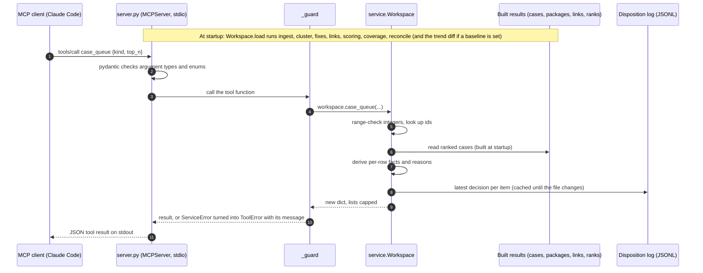
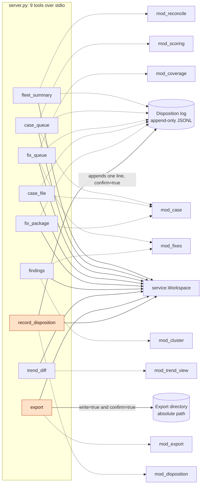
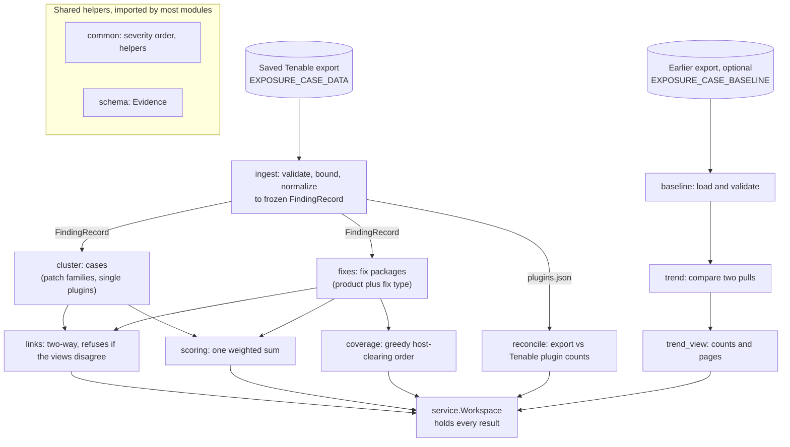
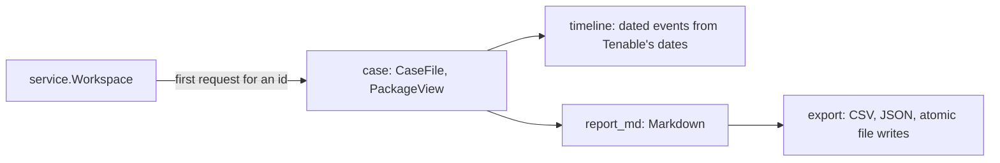
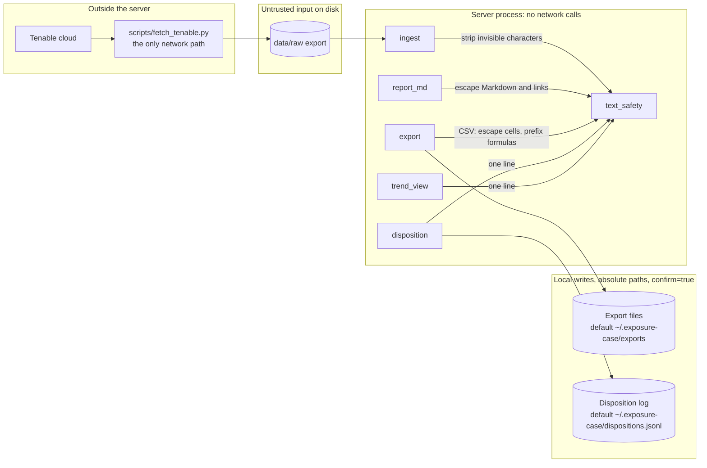

# Architecture

How Exposure Case Builder is put together and why. Decisions, the scoring table and the roadmap are in `ROADMAP.md`.

## Purpose and shape

A Tenable Vulnerability Management export is thousands of findings. Two groups need different things from it:

- the **security team** needs to know what is risky and why it ranks where it does;
- the **people who fix things** need to know what to do, what it clears, and on which hosts.

So the same findings are presented as two linked views: **cases** (risk) and **fix packages** (remediation). A deterministic engine builds both. Claude writes the cited narrative from the engine's results. The human analyst decides and records the decision. Code never issues a verdict, and Claude never invents a number.

```
 Tenable VM (cloud.tenable.com)
        |  scripts/fetch_tenable.py   <- the ONLY network path (GET/POST over HTTPS, no redirects)
        v
  data/raw/<export>/chunks/*.json, plugins.json        (gitignored)
        |  ingest.py        validate, bound, normalize -> FindingRecord (frozen)
        v
  cluster.py -> cases        fixes.py -> fix packages        (every active finding in exactly one of each)
        |                          |
        +------- links.py ---------+     scoring.py ranks both with one weighted sum
        |
  case.py (CaseFile / PackageView)   timeline.py   reconcile.py
        |
  report_md.py + export.py  -> Markdown / CSV / JSON          disposition.py -> append-only log
        |
  service.py  Workspace: every tool answer as capped JSON
        |
  server.py   stdio MCP server (9 tools)  <---- Claude Code + skills/exposure-case/SKILL.md
```

## Modules and responsibilities

| Module | Responsibility |
|---|---|
| `ingest` | Read saved chunks; validate and bound everything (file, total and record limits, known severities and states, tolerant optional fields); produce frozen `FindingRecord`s |
| `cluster` | Cases: one per patch family, one per other plugin; info findings excluded |
| `fixes` | Fix packages: normalized CPE product plus fix type read from the solution verb; per-action and contained impact |
| `coverage` | An additive greedy order over fix packages by hosts newly brought to zero urgent findings; the score rank is untouched. Findings are disjoint across packages, so the overlap that matters is hosts (see "Why these choices") |
| `baseline`, `trend`, `trend_view` | Optional trend diff: load and validate an earlier export, compare two pulls by finding id plus asset, plugin and port, and answer as counts or pages of ids. Read-only; absence is never reported as a fix |
| `links` | Two-way links with shares; refuses to build if the two views disagree about which findings exist |
| `scoring` | The only place weights live; ages anchored to the data, not the clock |
| `timeline`, `reconcile` | Dated events from Tenable's own dates; a trust check against Tenable's plugin counts |
| `case` | `CaseFile` (analyst) and `PackageView` (engineer), plain deterministic data |
| `report_md`, `export` | Rendering and the atomic file writers; `text_safety` neutralizes all Tenable text |
| `disposition` | The decision log: fixed vocabulary, bounded fields, append-only, tolerant reads |
| `service`, `server` | The tool layer; `service` is testable without a protocol, `server` is a thin wrapper |
| `common`, `schema` | Shared severity order and helpers; `Evidence`, the type every claim traces through |

## How the MCP server works inside

Four diagrams, drawn by GitHub from the Mermaid source. `tests/test_architecture_diagram.py` checks these facts against the code, and fails CI when they drift: the tool names, which tools are writes, the module list, that every tool goes through `service`, that tool-to-module edges point only at modules `service` imports, which modules use `text_safety`, and which tools touch the disposition log. The rest (the pipeline arrows, the sequence diagram, the wording) is checked by review, not by the test. The naming rule the test relies on: a tool node is `tool_<name>`, a module node is `mod_<name>`, a write tool carries `:::write`, and each edge is on its own line.

### 1. One request, end to end

The heavy work is done **once, when the server starts**: ingest, clustering, fix packages, links, scoring and the coverage order are never recomputed. A tool call reads those results and derives only what it shows (per-row facts, caps, shortened text). Case files and package views are built the first time they are asked for and then kept; the disposition log is re-read only when its size or modification time changes.



### 2. The nine tools and what each one touches

Every tool goes through `service.Workspace`. Write tools are drawn in orange. `export` is annotated as an overwrite even when it renders inline, because `write=true` replaces files of the same name.



Dotted edges point at the engine modules whose results the answer is built from (the test checks only that `service` imports each one). Of the read tools, five also read the disposition log, so a recorded decision shows up in queues and detail views.

### 3. The data pipeline, built once at startup



On demand, after startup: `case` builds a `CaseFile` or `PackageView` (with `timeline` for the dated events), and `report_md` and `export` render it.



### 4. Trust boundaries

`text_safety` runs in five places. Ingest strips invisible and bidirectional-override characters from every Tenable string, so they never reach a tool answer. The Markdown and CSV renderers escape markup, links and formulas. The JSON export is deliberately the exact unescaped copy (see the README), the source for any other markup that needs its own escaping. The disposition log and the trend view flatten text to one line. **Tool answers in JSON are not Markdown-escaped**: they are capped, never include plugin output, and the server's instructions tell the model that the text in them is data, not instructions.



## Invariants (each is tested)

1. Every active, non-info finding belongs to exactly one case and exactly one fix package; `links` raises otherwise.
2. Every number in a case or package traces to finding ids, and the `findings` tool returns the real records so a narrative cites genuine ids.
3. Output is deterministic: no wall-clock time, stable ordering, ids that never depend on input order.
4. A package's totals are what it *contains*; only an action's own row says what that action alone clears.
5. Nothing is written except behind `confirm=true`, to a fixed absolute location, atomically.
6. Tenable text never reaches a document as markup, a link or a formula, and never reaches the model as an instruction.
7. The engine and the server make no network calls.

## Trust boundaries

- **Tenable -> fetch script:** HTTPS to one host; redirects refused (they would forward the API keys); response, chunk-count and export-id limits; keys only from environment variables, held in an object whose `repr` hides them.
- **Disk -> ingest:** every file is untrusted: size caps, strict UTF-8 and nesting handling, record-level validation with the file and index in every error.
- **Engine -> documents and model:** `text_safety` escapes Markdown and HTML, turns bare URLs into inert code spans, prefixes spreadsheet formulas, and strips invisible and bidirectional-override characters. Plugin output is never returned by any tool. Stored analyst notes appear only in detail views, labelled as untrusted text.
- **Model -> tools:** all arguments are range-checked and enum-typed; item ids are looked up in the loaded export; there is no path parameter. `confirm` and `write` are strict booleans, but `confirm` is a convention: the client's tool-permission prompt is the real gate.

## Why these choices

- **Two views, not one.** A single risk-centred list buries the fix; a single fix-centred list hides the threats. Linking them lets each reader start from their own question.
- **Two queue lists.** KEV is common, so large patch backlogs saturate the exploit component and would outrank an exploited single vulnerability. Separate lists keep both visible without changing the approved weights.
- **Fix type from the solution's opening verb, not `has_patch`.** `has_patch` is true for 98% of plugins, including "Disable J-Web". The verb is the usable signal.
- **Coverage order counts hosts, not findings or cases.** Each finding is in exactly one package, so finding-level marginal coverage is a plain sum in any order. Case-level overlap was rejected: backlog cases span many packages, so nearly every step would clear no case and the tie-break would decide. A host is clear only when every package that touches it is applied (an all-of condition, not classic set cover), so a package's gain can rise as others are applied and the greedy has no approximation guarantee. Gains are updated only for packages that share a host with the one just placed. The order is a heuristic and the tool answer says so.
- **Stdlib engine, one runtime dependency.** The engine is small enough that a library would add more surface than it removes; `mcp` is needed to speak the protocol. pyTenable was evaluated and declined (`PRIOR_ART.md`).
- **A save-then-analyse split.** The fetch script writes files; everything else reads them. The analysis is reproducible, offline and testable against a committed sample.

## Known limits

Weights are a judgment, not validated; fix grouping is heuristic (first CPE, solution verb) and does not infer that one update supersedes another; near-duplicate plugin cases remain in the case view; the timeline has real fixed/reopened dates for only a minority of findings; tested on one tenant (160 hosts) on Windows 11. The README lists the main ones for users; `LIMITATIONS.md` has the full list.

## Extending

A new fix-type rule belongs in `fixes.classify_fix` with a test row; a new score component in `scoring.WEIGHTS` plus a `_component` function and a golden update; a new tool in `server._register_*_tools`, `service.Workspace`, `docs/exchange/mcp-server-listing.md`, `skills/exposure-case/SKILL.md` and diagram 2 above (the drift-guard tests, including `tests/test_architecture_diagram.py`, fail until all five agree); a new module goes in the diagrams too. Run `sh scripts/check_all.sh` before committing.
